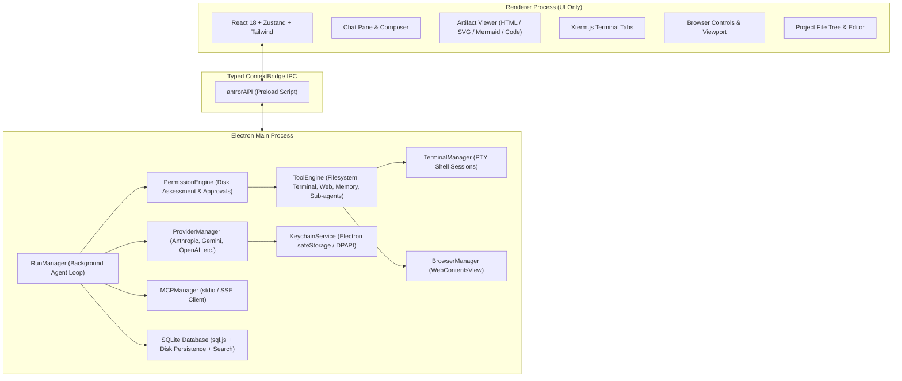

# Antror Desktop

<p align="center">
  <strong>The Cross-Platform Desktop AI Assistant</strong><br>
  Replicating the signature UI/UX and comprehensive capability set of Claude Desktop with multi-provider background execution, artifacts, native terminal, in-app browser, MCP, and project workspace syncing.
</p>

---

## 🌟 Key Features

### 1. Refined Claude Desktop UI/UX
- **Warm & Focused Aesthetic**: Meticulously designed around warm canvas and charcoal tones with terracotta brand accents.
- **Collapsible Thinking Accordions**: Deep reasoning streams with live duration indicators, thought length, and expandable scratchpads (Anthropic Claude 3.7, DeepSeek R1, OpenAI o1/o3-mini, Gemini 2.5).
- **Streaming Markdown & Math**: Rich GitHub-flavored markdown with full KaTeX LaTeX equation rendering and syntax-highlighted code blocks with direct "Open as Artifact" actions.
- **Model Picker in Composer**: Real-time searchable dropdown supporting instant model switching per chat and custom model IDs.
- **Tool-Call Cards**: Status spinners, expandable parameter views, execution time tracking, and collapsible outputs.

### 2. Multi-Provider AI Core
Unified `streamChat()` abstraction normalizing streaming text deltas, reasoning/thinking deltas, tool calls, and token usage across 18+ providers:
- **Anthropic**: Claude 3.7 Sonnet (Hybrid Reasoning), Claude 3.5 Sonnet, Claude 3.5 Haiku, Claude 3 Opus
- **Google Gemini**: Gemini 2.5 Flash, Gemini 2.5 Pro, Gemini 1.5 Pro/Flash
- **OpenAI**: GPT-4o, GPT-4o-mini, o3-mini, o1
- **DeepSeek**: DeepSeek R1 (Reasoner), DeepSeek V3 (Chat)
- **Groq**: Ultra-fast LPU inference (Llama 3.3 70B, Llama 3.1 8B, Mixtral 8x7B)
- **Mistral AI**: Mistral Large 2, Codestral, Mistral Small
- **xAI**: Grok 2, Grok 2 Vision
- **OpenRouter, Together AI, Fireworks AI, Perplexity, Cohere**
- **Local LLMs**: Ollama (`localhost:11434`), LM Studio (`localhost:1234`)
- **Enterprise & Custom**: Azure OpenAI, AWS Bedrock, Google Vertex AI, and Custom OpenAI-compatible endpoints

### 3. Background Execution Engine (`RunManager`)
- **Independent Main Process Execution**: AI agent loops live inside the Electron main process, completely decoupled from active UI views.
- **Survives View Switching**: Navigate to Settings, switch between chats, or inspect files mid-turn—the agent continues streaming and saving state directly into SQLite.
- **Concurrent Multi-Chat Execution**: Multiple chat sessions can execute simultaneous agent loops with live animated pulse badges in the sidebar.
- **Desktop Notifications**: Native OS notification delivered when long-running tasks conclude.
- **Immediate Interruption**: Explicit cancelation via AbortController on stop button press.

### 4. Interactive Artifacts
- **Preview & Code Modes**: Dedicated side panel for generated code, HTML, React, SVG, Mermaid diagrams, and Markdown documents.
- **Live Sandboxed Previews**: Instant interactive HTML and Tailwind previews rendered in isolated frames.
- **Mermaid Diagrams**: Dynamic rendering of flowcharts, sequence diagrams, and architecture maps.
- **Save to Project**: Direct persistence of artifacts into the active workspace project folder.

### 5. Native Embedded Terminal
- Real shell access (PowerShell/cmd on Windows, bash/zsh on macOS & Linux).
- Powered by `@xterm/xterm` with multiple tabs, scrolling, color themes, and clipboard integration.
- Model `terminal_execute` tool runs commands with working directory persistence, live streaming, timeouts, and user takeover.

### 6. Built-in In-App Browser
- Isolated browser panel with navigation toolbar (Back, Forward, Reload, Address bar).
- Model-driven navigation and page text/DOM extraction.
- **"Ask about this page"**: One-click extraction of the current page into chat context for immediate summarization and analysis.

### 7. Model Context Protocol (MCP)
- Full client implementation supporting `stdio`, `SSE`, and streamable `HTTP` transports.
- Compatible with the standard `mcpServers` configuration format.
- Resolves real user shell `PATH` (`npx`, `uvx`, `python`) for packaged environments.
- Settings > MCP: Add/edit servers, enable/disable toggles, live test connection, and tool discovery.

### 8. Project Workspaces & Local Filesystem
- Real filesystem root at `~/Antror/` (`Projects/`, `Artifacts/`, `Memory/`, `Logs/`, `Config/`).
- Every project lives in `~/Antror/Projects/<name>/` as a standard directory openable in VS Code, Finder, or Explorer.
- Built-in file tree navigator and code editor with save operations.

### 9. Privacy, Memory & Security
- **Local SQLite Database**: All conversations, messages, artifacts, and memories are stored locally in SQLite with full-text search (FTS).
- **OS Keychain Encryption**: API keys are encrypted via Electron `safeStorage` (Windows DPAPI, macOS Keychain, Linux Secret Service) with zero plaintext disk storage.
- **Permission System**: 4 security modes (`ask_every_time`, `auto_approve_edits`, `plan_mode`, `full_auto`) with interactive approval dialogs for high-risk tools.
- **Persistent Long-Term Memory**: Autonomous fact saving and recall across conversations.

---

## 🏗️ Architecture



---

## 🚀 Getting Started

### Prerequisites
- Node.js 20+ or 24+
- npm 10+

### Installation & Run

```bash
# Clone the repository
git clone https://github.com/your-username/antror-desktop.git
cd antror-desktop

# Install dependencies
npm install

# Run tests
npm test

# Build production assets
npm run build

# Start desktop app
npm start

# Or run in live development mode
npm run dev
```

---

## 🧪 Testing

The repository includes comprehensive unit and integration tests powered by Vitest:

```bash
npm run test
```

### Test Coverage
- `tests/providers.test.ts`: Provider adapters, model listings, authentication error handling.
- `tests/permissions.test.ts`: Risk assessment, destructive command detection, permission modes (`ask_every_time`, `auto_approve_edits`, `plan_mode`, `full_auto`).
- `tests/run-manager.test.ts`: Main process background execution, active run state queries, cancellation.
- `tests/mcp.test.ts`: MCP server registration, tool resolution, transport connections.
- `tests/e2e.test.ts`: End-to-end flows covering OS keychain encryption, background run survival across navigation, MCP execution, and terminal tool command execution.

---

## 📦 Packaging & Release

Cross-platform installers are generated via `electron-builder`:

```bash
# Package for local OS architecture
npm run pack

# Build distribution installers (.exe on Windows, .dmg on macOS, .AppImage on Linux)
npm run dist
```

Packaging configurations:
- **macOS**: Signed `.dmg` and `.zip` with hardened runtime entitlements.
- **Windows**: Dual targets (NSIS installer with custom directory selection + Portable `.exe`).
- **Linux**: Standalone `.AppImage` and `.deb`.

---

## 📄 License
MIT License. Crafted with precision for high-performance AI desktop pairing.
